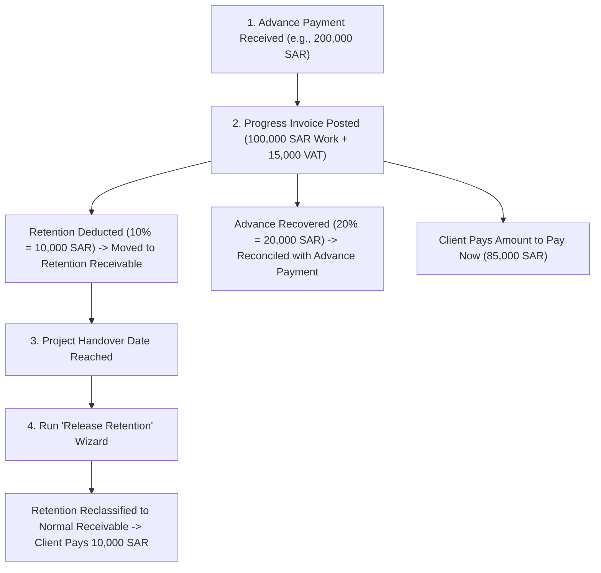

# Retention and Advance on Invoices (`account_retention_advance`)

[](https://www.odoo.com)
[](https://www.gnu.org/licenses/lgpl-3.0)
[]()

Manages **contractor retention guarantees** and **advance payment recovery** on customer progress billing invoices for contracting and construction projects in Saudi Arabia (and GCC).

---

## Business Background

In contracting projects, the financial flow typically follows this lifecycle:
1. **Advance Payment**: Upon contract signing, the client pays a lump-sum advance (e.g., 20% of contract value).
2. **Monthly Progress Invoices**: The contractor bills monthly for the work completed:
   - **Retention Guarantee**: The client withholds a portion (typically 10% of untaxed work) as a performance guarantee, due only at project handover (often 1–2 years later).
   - **Advance Recovery**: The client recovers part of the advance already paid (e.g., 20% of untaxed work) until the advance is fully depleted.
   - **Statutory VAT (15%)**: Must be computed on the **full work completed**, not on the net amount after deductions.
   - **Amount to Pay Now**: The client pays only the residual: `Work Done + VAT - Retention - Advance Recovery`.
3. **Retention Release**: At project handover, the retained amounts are reclassified to normal receivable and collected.

---

## Features

- **Automated Ledger Reclassification**:
  - Automatically posts a retention holding entry: moves the retention amount from standard *Accounts Receivable* to a dedicated *Retention Receivable* account with maturity set to the expected handover date.
- **Advance Payment Reconciliation**:
  - Automatically matches and partially reconciles the invoice against the selected customer advance payment, reducing the customer's open advance balance in real time.
- **Residual Amount to Pay Now**:
  - The invoice open residual reflects exactly the net amount due (`Amount to Pay Now`).
- **Proportional Credit Notes**:
  - Reversing an invoice (fully or partially) automatically reverses the retention entry and restores the recovered advance balance proportionally.
- **Safe & Idempotent Reset to Draft**:
  - Resetting to draft unreconciles and cleans up retention entries cleanly without creating duplicates when re-posted.
  - Prevents drafting if retention has already been released to the client.
- **Retention Release Wizard**:
  - Release retention per invoice or in bulk by customer/project.
  - Generates reclassification entries back to normal receivable with the release date maturity.
- **Consolidated Reporting & Excel Export**:
  - Interactive report by Customer and Project showing Invoiced, Retention Held, Released, Balance, Advance Received, Recovered, and Advance Balance as of any date.
  - Formatted Excel (`.xlsx`) export with native `=SUM(...)` formulas.
- **Compliant PDF Invoice**:
  - QWeb template inherited to clearly display work done, VAT (15%), Less Retention, Less Advance Recovery, and Amount to Pay Now.
- **Enterprise & Multi-Company Ready**:
  - Multi-currency conversion support (e.g. USD billing on SAR company).
  - Respects company accounting lock dates.

---

## Installation & Dependencies

### Dependencies
- Odoo Modules: `account`, `sale`
- Python Packages: `xlsxwriter` (required for Excel reporting export)

```bash
pip install xlsxwriter
```

---

## Configuration

### 1. Retention Receivable Account
1. Go to **Accounting > Configuration > Chart of Accounts**.
2. Create an account for retention:
   - **Name**: `Retention Receivable`
   - **Type**: `Receivable` (`asset_receivable`)

### 2. Accounting Settings
1. Go to **Accounting > Configuration > Settings**.
2. In the **Contractor Invoicing (Retention & Advance)** section:
   - **Retention Receivable Account**: Select the account created above.
   - **Default Retention %**: Set default percentage (e.g. `10.0%`).
   - **Retention Journal**: Select a general journal (defaults to Miscellaneous Operations).
3. Click **Save**.

### 3. Bank Journal Outstanding Account (Odoo Enterprise)
1. Go to **Accounting > Configuration > Journals > Bank**.
2. Under the **Incoming Payments** tab, ensure the **Manual Payment** line has its **Payment Account** set to `Outstanding Receipts` (or the Bank account).

---

## Typical Usage Workflow



### 1. Record Advance Payment
- Navigate to **Accounting > Customers > Payments**.
- Register an inbound customer payment for the project advance (e.g., `200,000.00 SAR`).
- The payment tracks `Remaining Advance: 200,000.00 SAR`.

### 2. Create Progress Invoice
- Navigate to **Accounting > Customers > Invoices**.
- Create an invoice for work done:
  - Line: `Structural Work` — `100,000.00 SAR`, `VAT 15%` (`15,000.00 SAR`). Gross Total = `115,000.00 SAR`.
- In the **Retention & Advance** tab:
  - Set **Retention %**: `10.00%` (`10,000.00 SAR`). Set **Expected Handover Date**.
  - Select **Advance Payment to Recover** and set **Advance Recovery %**: `20.00%` (`20,000.00 SAR`).
  - **Amount to Pay Now**: `85,000.00 SAR`.
- Click **Confirm**:
  - Residual becomes `85,000.00 SAR`.
  - Retention journal entry posted (`Debit Retention Receivable 10,000 / Credit Accounts Receivable 10,000`).
  - Advance payment balance updates to `180,000.00 SAR`.

### 3. Releasing Retention
- From the invoice header, click **Release Retention** (or navigate to **Accounting > Customers > Release Retention**).
- Confirm the release date and amount.
- Reclassification entry posted (`Debit Accounts Receivable 10,000 / Credit Retention Receivable 10,000`).
- The retention is now due for standard collection.

### 4. Credit Notes
- If an invoice is reversed (e.g., 50% credit note), the system automatically:
  - Reverses 50% of the retention holding entry.
  - Restores 50% of the recovered advance back to the advance payment balance.

### 5. Reporting
- Navigate to **Accounting > Reporting > Retention & Advance Report**.
- Filter by Customer and Project as of any cut-off date.
- View on-screen or export formatted `.xlsx` workbook.

---

## Accounting Entries Summary

| Step | Journal | Debit | Credit | Amount (SAR) |
| :--- | :--- | :--- | :--- | :--- |
| **1. Advance Payment** | Bank | Outstanding Receipts | Accounts Receivable | 200,000.00 |
| **2. Customer Invoice** | Customer Invoices | Accounts Receivable<br>—<br>— | —<br>Revenue (Work Done)<br>VAT 15% | 115,000.00<br>100,000.00<br>15,000.00 |
| **2a. Retention Entry** | Miscellaneous | Retention Receivable | Accounts Receivable | 10,000.00 |
| **2b. Advance Match** | Partial Reconcile | (Accounts Receivable) | (Accounts Receivable) | 20,000.00 |
| **3. Client Payment** | Bank | Outstanding Receipts | Accounts Receivable | 85,000.00 |
| **4. Retention Release** | Miscellaneous | Accounts Receivable | Retention Receivable | 10,000.00 |
| **5. Retention Collection** | Bank | Outstanding Receipts | Accounts Receivable | 10,000.00 |

---

## Technical Information

- **Module Name**: `account_retention_advance`
- **Version**: `19.0.1.0.0`
- **Author**: Sajith
- **License**: LGPL-3
